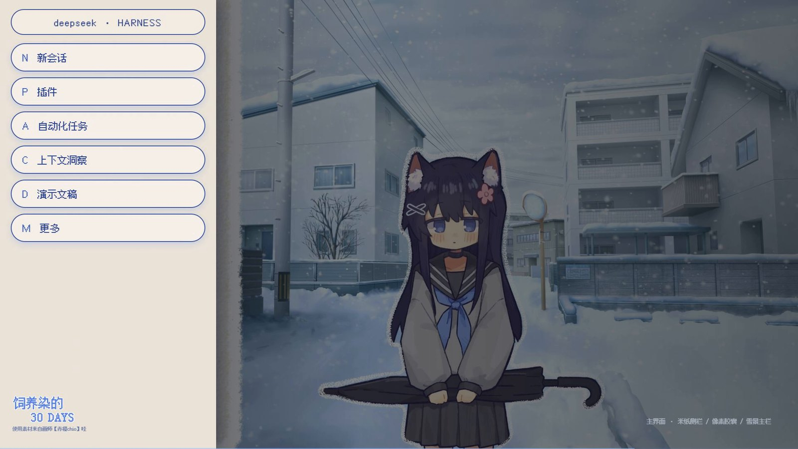

# 启动界面 · dsh-boot

给 DeepSeek Harness 套一张《饲养染的 30 DAYS》主菜单的皮：**开机启动幕 → 撕纸侧栏滑入 → 纸化开露出主界面**。



▶ **[15 秒演示视频（1920×1080，原生渲染，非录屏）](docs/demo.mp4)**

## 现在是什么样

- **启动幕**：游戏标题字在雪景上淡入并擦除，下面走载入日志与进度条，随后撕纸侧栏从左侧滑入；任意键或点击可跳过。
- **主界面**：左侧米色纸侧栏 + 像素胶囊（`N 新会话 / P 插件 / A 自动化任务 / C 上下文洞察 / D 演示文稿 / M 更多`），
  右侧雪景底图（静帧或循环动画），底部状态栏透明。
- **侧栏落款**：标题字 + 一行画师署名。

## 怎么用

- 启动时自动播放；**任意键 / 点击**跳过；
- `Alt+B` 重播启动幕；`?boot=0` 不播启动幕；`?skin=0` 关皮肤；
- 主栏动态底图在插件设置里切（`dsh.skin.motion`），或 `?motion=0|1`。

## 安装

完整的安装/卸载步骤见 **[INSTALL.md](INSTALL.md)**。三步：克隆 → `npm run assets && npm run build` →
在 profile 的 `package.json` 里加一条 `link:` 依赖 + 把包名加进 `dsh.profile.bundles`，`pnpm install` 后重启 DSH。

## 自己构建

仓库已包含构建所需的原作素材（`assets/raw/`，经制作组同意随项目分发）与 Fusion Pixel 字体，
克隆后跑两步即可：

```bash
npm run assets   # 生成 assets/*.b64（需要 Python 3 + Pillow + fonttools + brotli）
npm run build    # 生成 client.js
```

细节见 [BUILD.md](BUILD.md)。

## 素材来源与署名（重要）

本皮肤是**非盈利同人作品**。素材来自《饲养染的 30 DAYS》/《终点站》，条款如下：

- 全部美术素材由画师 **赤橙chio** 绘制，画师保留对美术素材的解释与所有权；
- 素材包**已获制作组同意**，可随本项目分发（其它场合仍请勿二次搬运）；
- **严禁**利用本素材包或游戏本体进行**任何形式的商业盈利**行为。

**需要署名的情况**（二创图片/视频、视频里出现明显立绘/SD/CG 时，把署名放在简介或置顶评论）：

- “使用素材来自画师【赤橙chio】哇”
- “游戏是【饲养染的30 DAYS】/【终点站】哇”
- “游戏制作组是【繁星相位制作组】哇”

其他署名：

- **TakWolf**（https://takwolf.com）—— Fusion Pixel 像素字体，SIL OFL-1.1，保留字体名 `Fusion Pixel`，许可全文见 `licenses/Fusion-Pixel-OFL-1.1.txt`；
- **Ziyang Song**（https://github.com/yannicksong0106）—— `dsh-550c-boot`，声明与 patch 格式的参考（MIT）。

完整条款、素材清单与自绘部分见 [CREDITS.md](CREDITS.md)。

## 许可

本仓库**代码**为 MIT（见 [LICENSE](LICENSE)）；原作素材与 Fusion Pixel 字体按各自的许可使用，且**不随本仓库分发**。
